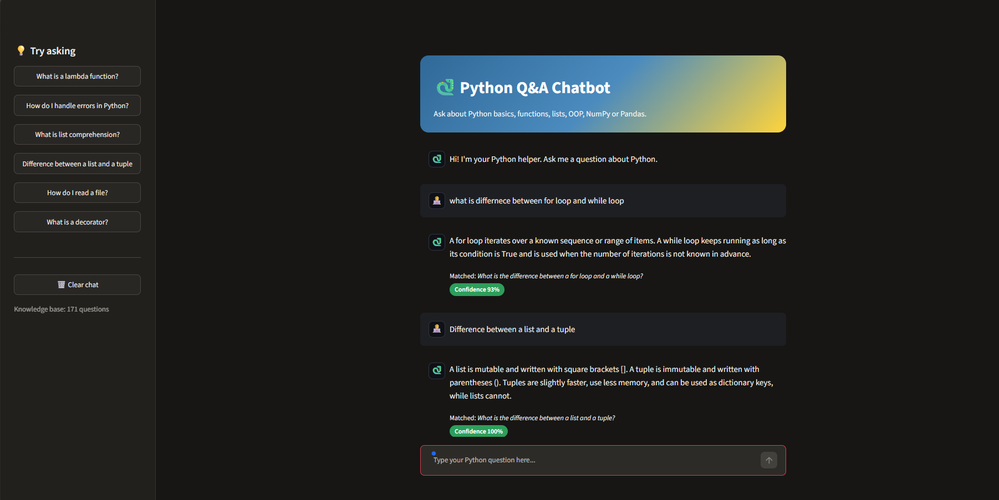
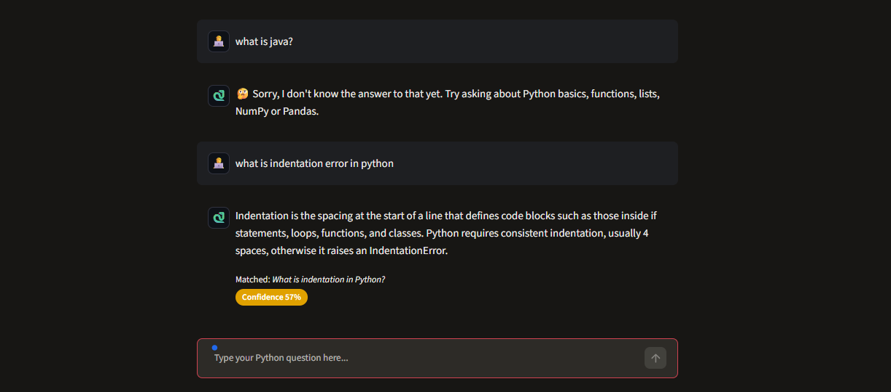

# Python Q&A Chatbot

A chatbot that answers Python questions using NLP (TF-IDF + cosine similarity).
Built as an internship project covering Python, NumPy, Pandas, ML and NLP.

## How it works
1. Questions and keywords are cleaned (lowercase, symbol handling, stop-word removal, lemmatization).
2. TF-IDF converts every stored question into a vector (single words and word pairs).
3. The user's question is converted the same way and compared to all stored questions using cosine similarity.
4. The best match is returned if its score is at least 0.2. Otherwise the bot says it doesn't know.

## Results
- 10/10 Python test questions matched the correct answer (some were used while tuning keywords, so this shows the method works rather than being a blind test)
- 5/5 off-topic questions correctly rejected (score 0.00 at a 0.2 threshold)
- Knowledge base: 171 questions

## Final Output

Correct answers with confidence badges:

Off-topic question rejected:

## Project structure
- `data/` - datasets (final file: python_qa_final.csv)
- `notebooks/` - cleaning, preprocessing and model experiments
- `outputs/` - final output screenshots and test results
- `preprocess.py` - text cleaning function
- `chatbot.py` - chatbot logic
- `app.py` - Streamlit web app

## Run it
    pip install -r requirements.txt
    streamlit run app.py

## Limitations
- Matching is keyword based, so a question worded very differently from the dataset can be missed.
- Some rows need extra keywords (for example "errors" for exception handling).
- The bot only knows what is in the dataset.